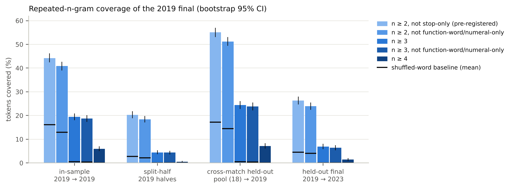
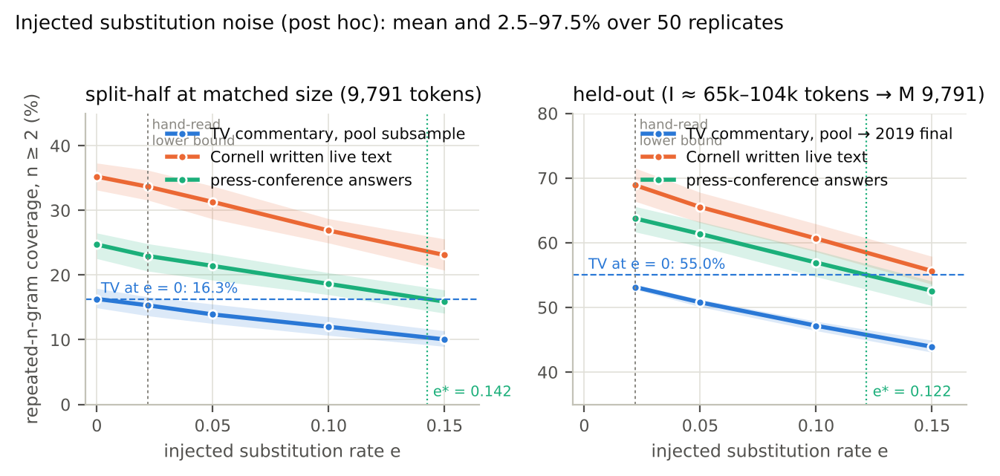
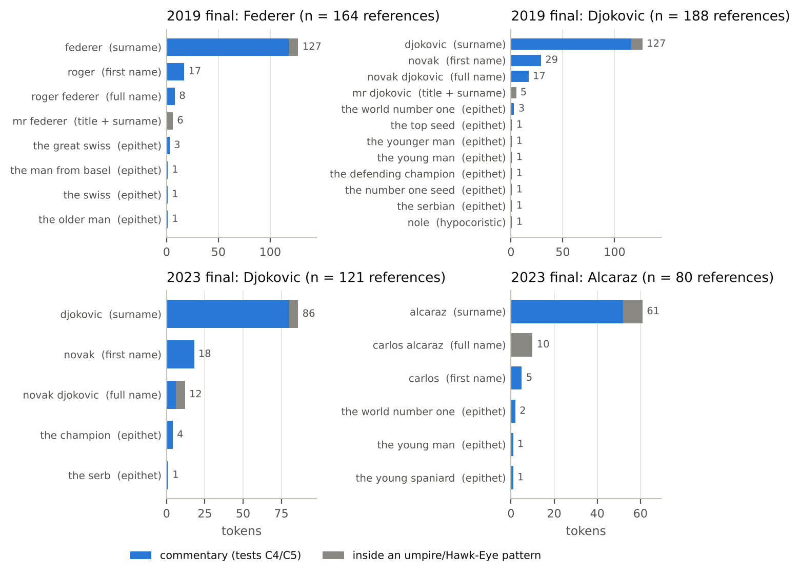
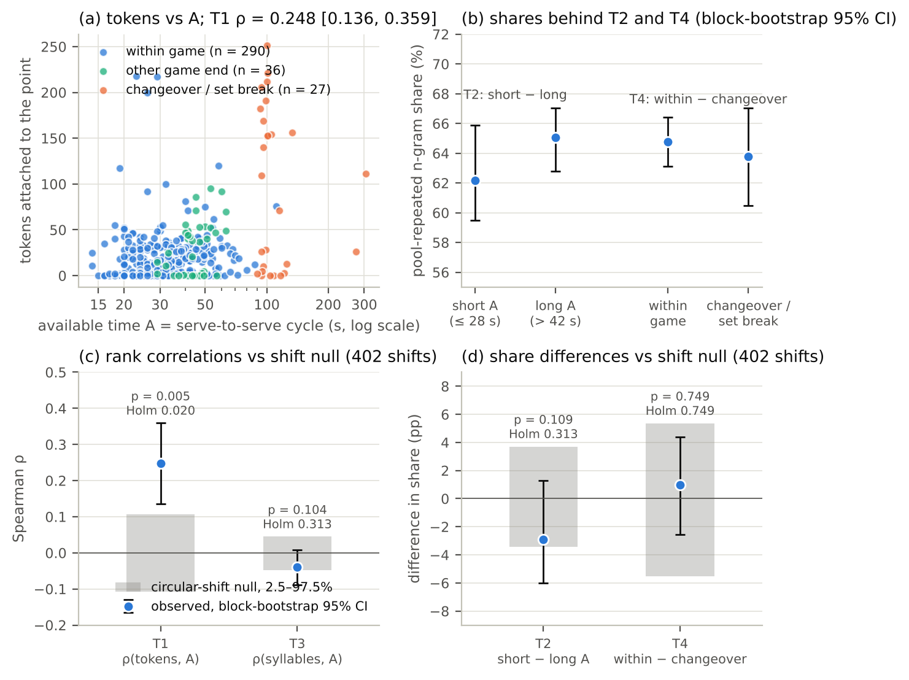
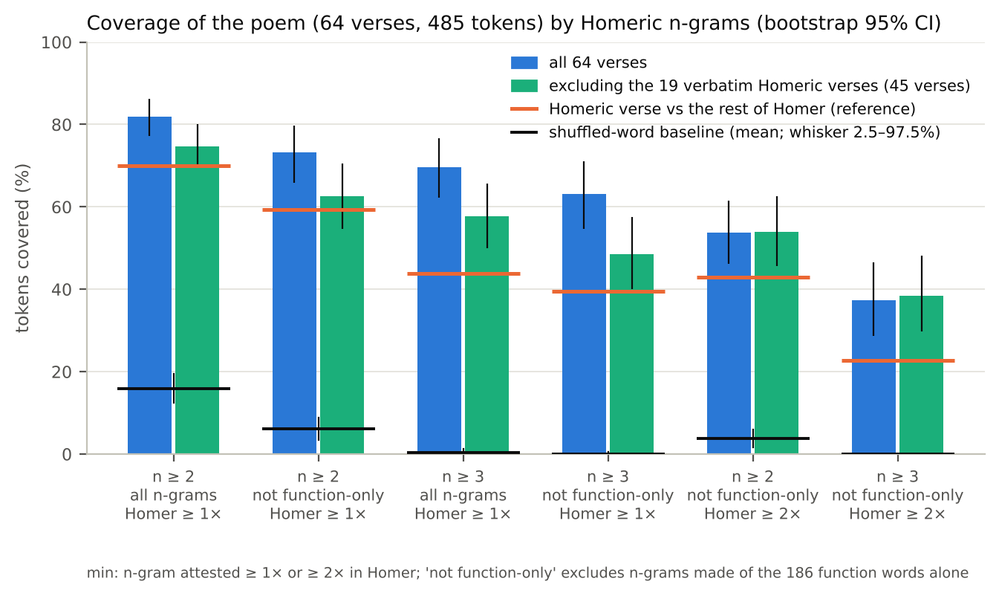

# Formula, economy and the clock: Parry–Lord measures on the television commentary of the 2019 Wimbledon final, with a Homeric narrative of the match
<!-- word counts (paper/wordcount.py): main text (sections 1-9 and Data and code) 4682 words of prose, 7671 with tables, captions and quoted passages; references 1222 words; appendices A-C 3168 words; Unicode NFC: yes -->
<!-- length: the plan (STATUS.md, Phase 6) said about 4,000 words of prose; Phase 2b (§5) was added by the human after Phase 2 closed and accounts for the excess over that figure. Revised 2026-10-11 after review/critic_paper_v1.md (1 critical, 6 major, 19 minor; the cuts of its §7 applied). -->

## 1. The question

Parry's studies of the epithet and the formula (Parry 1928, 1930, 1932; collected in Parry 1971) made a claim about production as much as about style: a diction of formulae, each regularly used under the same metrical conditions to express a given essential idea [wording unverified against the page], arranged in noun-epithet systems of wide extension and strict economy, is what lets a singer compose hexameters at speaking pace; Lord (1960; 3rd ed. 2019) made this a theory of composition in performance. Independent of the hexameter, the theory predicts, wherever discourse must be produced continuously against a rhythm set from outside, a large stock of reusable phrases, alternatives of different length for each recurrent idea with little redundancy at any one length (extension and economy, Parry's *thrift*), and a choice among them governed by the slot rather than the idea; so Kuiper argued of auctioneers, race callers and sportscasters (Kuiper and Haggo 1984, abstract only read; Kuiper and Austin 1990; Kuiper 1996, 2009; titles only). Tennis adds a cycle whose lengths are recorded to the second.

Three things were tested, pre-registered, on the television commentary of the 2019 Wimbledon men's final (Djokovic d. Federer 7–6(5) 1–6 7–6(4) 4–6 13–12(3)), with the 2023 final held out: the formula inventory and its coverage within, across and beyond the match; the players' noun-epithet system and its binding to the time available; and the serve-to-serve cycle as a frame (§§3–4). An exploratory phase (§5) asked whether the stock is shared across broadcasts and what the measure counts. The analogy was then run backwards: a 64-line Homeric narrative of the match was composed under Parry's constraints and its records measured (§6), and the Greek craft words for composition, stitching and weaving, set against those records (§7).

## 2. Corpus and limits

The spoken corpus is the TennisVL test split released with Liu et al. (2026): WhisperX transcripts (Bain et al. 2023) of one television commentary track per match, for the rally clips of 20 Grand Slam matches of 2019–2025. For the 2019 final, 373 of 481 clips carry text, 9,702 words after de-duplication of text repeated across consecutive clips (17.7% of the raw words); the broadcaster is unnamed, probably BBC Television [unverified: the commentators address "Boris" 19 times and "Tim" 7 times]. The 2023 final (271 of 368 clips with text, 7,168 words) was excluded from every identification step; the other 18 matches form a reference pool (103,074 words). TennisVL's hit times, Sackmann's point-by-point match clock (1 s resolution, 422 points) and the Match Charting Project's shot sequences align point by point (473 of 481 clips; constant video offset 26.72 s, residual SD 0.28 s). The written contrast is the live-text corpus of Fu, Danescu-Niculescu-Mizil and Lee (2016): 3,962 updates from one outlet, 175,569 words, of other matches, undated; the player answers of the same release's press-conference transcripts (81,974 answers, 358 interviewees, 2007–2015; edited stenography [unverified]) are a spoken non-commentary baseline only. <!-- corpus/README.md §0, §2–4, §7; corpus/SOURCES.md §1 -->

The prominent limitation (Phase 0): no acceptable source gives the same match from a second broadcaster, from radio or in two media, and the transcripts carry no audio, speaker labels or word-level times; the clip window is undocumented (the first score call in a clip is the score *after* the clip's point in 40 of 59 cases); and the word error rate is unknown, a hand-read 500-word sample giving 22 visible errors per 1,000 (Wilson 95% CI 12–39), a lower bound. Commentator, broadcaster, match and medium are therefore confounded, and the umpire and Hawk-Eye are one voice with the commentators (§9). <!-- corpus/README.md §0, §4, §7.3; STATUS.md Phase 0 -->

## 3. Methods

**Measure.** Tokens are `[a-z0-9]+(?:'[a-z0-9]+)*` of case-folded NFKC text, and n-grams never cross an utterance. **Repeated-n-gram coverage** is the share of tokens of a measurement set M inside an n-gram (2 ≤ n ≤ 12) that occurs in at least two utterances of an identification set I and is not made only of 182 listed function words: a rate of lexical repetition, not Parry's formula, and the comparison with Duggan's (1973) "formulaic density" an analogy. Stricter variants and one-slot **systems** (frames with a `<NAME>`, `<NUM>` or open slot) are reported separately, and the four designs are Table 1's columns. Corpus contrasts subsample each corpus to the 2019 size (9,791 tokens; R = 1,000 replicates, held-out 50) and take the 95% interval of paired replicate differences as the inferential statistic; a post hoc check injects substitution noise and reports the rate e* at which a baseline mean reaches the TV value.

**Economy, extension, timing.** References to the players are inventoried by a fixed matcher, with a syntactic slot from a spaCy parse and a syllable count from the CMU dictionary; references inside umpire and Hawk-Eye patterns are excluded. C3–C5 are defined in Table 2 (D, the distinct forms summed over player × slot × dead-time-tercile cells, against 10,000 permutations of the tercile labels; Spearman ρ of syllables with the dead time before the point; pool-identified coverage between terciles of the time before, and after, a clip's point). The metre hypothesis, re-specified before any test ran because intonation units need audio, takes the point as unit, its clips' text, and the serve-to-serve cycle A_p = ElapsedTime(p + 1) − ElapsedTime(p) as frame, with "formulae" the n-grams occurring three times in two pool streams (9,609 types): T1 (tokens track A) is a precondition, T2–T4 discriminate (Table 4); minimum detectable effects (MDE, 80% power) were simulated afterwards.

**Pre-registration.** Plans preceded scripts and results (6db5d39, de5788a; 951adb5); later changes are labelled addenda, and two adversarial reviews (`review/critic_analysis_v1–2.md`) changed no confirmatory definition, threshold or rule, only the reporting of C1/R1/C2 and the token set of C4/C5. §4 is confirmatory; §5 and §6 are exploratory. <!-- git log; review/ -->

## 4. Results of the pre-registered tests (Phase 2)

### 4.1 Inventory and coverage

**Table 1. Repeated-n-gram coverage of the 2019 final by design and definition** (% of tokens; bootstrap 95% CI; shuffled rows: mean and 2.5–97.5% over 200 replicates).

| definition | in-sample (2019 → 2019) | split-half (2019 halves) | pool (18 matches) → 2019 | 2019 → 2023 (held-out final) |
|---|---|---|---|---|
| n ≥ 2, not stop-only (pre-registered (a)) | 44.2 [42.5, 46.3] | 20.3 [18.9, 21.8] | 55.0 [53.1, 57.0] | 26.3 [24.7, 28.0] |
| n ≥ 2, not function-word/numeral-only | 40.8 [39.0, 42.6] | 18.4 [17.1, 19.8] | 51.2 [49.4, 53.1] | 24.0 [22.4, 25.5] |
| n ≥ 3 | 19.4 [18.0, 20.9] | 4.5 [3.7, 5.3] | 24.4 [22.7, 26.1] | 6.9 [5.8, 8.0] |
| n ≥ 3, not function-word/numeral-only | 18.7 [17.3, 20.2] | 4.4 [3.6, 5.1] | 23.8 [22.1, 25.4] | 6.4 [5.3, 7.5] |
| n ≥ 4 | 6.0 [5.0, 7.0] | 0.5 [0.2, 0.8] | 7.1 [6.0, 8.3] | 1.4 [0.9, 2.0] |
| (a) + one-slot systems (b), base definition | 48.3 [46.4, 50.5] | 23.3 [21.8, 25.1] | 63.9 [61.9, 65.9] | 29.9 [28.2, 31.7] |
| shuffled-word baseline, base definition (mean [2.5–97.5%]) | 16.2 [15.2, 17.3] | 2.8 [2.2, 3.5] | 17.2 [16.3, 18.1] | 4.6 [4.0, 5.2] |
| shuffled-word baseline, n ≥ 3 | 0.5 [0.2, 0.8] | 0.0 [0.0, 0.0] | 0.5 [0.3, 0.7] | 0.0 [0.0, 0.1] |
| tokens measured | 9791 | 9791 | 9791 | 7216 |
<!-- analysis/formulas/results/coverage_family.csv (coverage, CIs, shuffled baselines); density_main.csv ((a)+(b) row); generated by paper/figures/tables.py -> paper/figures/tables/table1_coverage.md -->

*Figure 1.* Coverage by design and definition; black dashes, the shuffled-word baseline (`fig1_coverage.py`).

The final repeats within itself 44.2% of its tokens under the base definition, but bigrams carry the figure (*the first*, *a little*); at n ≥ 3 it is 19.4% against a shuffled floor of 0.5%, and the split-half design gives 20.3% (4.5%). Identifying repeats on the 18 other matches raises coverage to 55.0% (24.4%): 919 of the final's 1,194 repeated types occur in another match and 275 in none, so most of the stock is shared across matches and, the pool being other broadcasts [unverified], across commentators. One-slot systems add 3–9 points; the most widespread are the score-call frames (`<NUM> 15`, `40 <NUM>`), which absorb the ASR's *13*, *14* and *50* (29 of 195 fillers) and are the umpire's as much as the commentators'. <!-- maximal_match_2019.csv; formulas_2019.tsv; formulas_cross_stream.csv; systems_2019.tsv; analysis/formulas/report.md §2 -->

### 4.2 Corpus contrasts and the noise check

At matched size, split-half coverage is 16.2% for TV commentary, 35.3% for the Cornell live text and 24.6% for press answers (n ≥ 3: 3.6, 14.2, 8.2%). C2, the TV–Cornell difference of −19.1 points [−22.1, −16.3], is a corpus difference (matches, outlet, period, raw ASR against edited prose, clips against whole updates), not attributable to medium. C1 and R1, the held-out contrasts with press answers (Table 2), are **indeterminate pending a WER estimate**: injected substitution noise brings the press value to the TV value at e* = 0.122 (held-out) and 0.142 (split-half), while the only estimate of the TV error rate is the lower bound 0.022, and the model is no bound on real ASR error; the sign of the Cornell contrast is secure under noise in the split-half design only (§9.2). <!-- density_medium.csv; confirmatory.csv; asr_noise_sensitivity.csv; asr_noise_summary.json -->

*Figure 2.* Coverage against injected substitution rate, split-half (left) and held-out (right); dotted verticals mark e* (`fig2_noise.py`).

### 4.3 Confirmatory tests

**Table 2. Confirmatory tests (2019 final, C) and replication (2023 final, R).** Coverage in %, differences in points; for C1/R1/C2 the inferential statistic is the replicate interval; for C3–C5 a permutation p with Holm within the family; MDE at 80% power.

| id | test | estimate | 95% interval | p (pre-registered statistic) | p (Holm) | MDE (80% power, α = 0.05 / Bonferroni) | verdict |
|---|---|---|---|---|---|---|---|
| C1 | coverage, pool → 2019 final, minus press answers (held-out; I ≈ 100k → M 9.7k) | 55.0 vs 66.1; diff -11.1 pp | [-13.9, -8.0] pp (replicate differences) | 0.0002 (= floor 2/(R+1); uncalibrated) | — | — | indeterminate pending a WER estimate |
| R1 | coverage, pool → 2023 final, minus press answers (held-out) | 59.5 vs 66.1; diff -6.7 pp | [-9.5, -3.6] pp (replicate differences) | 0.0002 (= floor 2/(R+1); uncalibrated) | — | — | indeterminate pending a WER estimate |
| C2 | split-half coverage at 2019 size: TV pool minus Cornell live text (corpus contrast) | 16.2 vs 35.3; diff -19.1 pp | [-22.1, -16.3] pp (replicate differences) | 0.0020 (= floor 2/(R+1); uncalibrated) | — | — | corpus difference: 95% interval of differences excludes 0 (not attributable to medium) |
| C3a | coverage (pool-identified), shortest minus longest tercile of dead time before the point | 55.4 vs 55.1; diff +0.4 pp | [-4.0, +4.6] pp (bootstrap) | 0.8770 (permutation) | 1.0000 | 6.4 / 7.9 pp | not rejected |
| C3b | coverage (pool-identified), shortest minus longest tercile of time after the point | 52.5 vs 55.1; diff -2.5 pp | [-7.3, +2.6] pp (bootstrap) | 0.3029 (permutation) | 0.9088 | 7.0 / 8.5 pp | not rejected |
| R3a | as C3a, 2023 final | 60.6 vs 59.1; diff +1.5 pp | [-2.9, +5.9] pp (bootstrap) | 0.5199 (permutation) | 0.6947 | 6.5 / 7.9 pp | not rejected |
| R3b | as C3b, 2023 final | 57.1 vs 60.2; diff -3.1 pp | [-8.2, +1.9] pp (bootstrap) | 0.2304 (permutation) | 0.6947 | 7.2 / 8.5 pp | not rejected |
| C4 | thrift: distinct name forms per player × slot × dead-time tercile, below permutation null | D = 86 vs null mean 84.2 | null 95%: [81, 88] | 0.8932 (one-sided permutation) | 1.0000 | θ = 0.30 / 0.38 | not rejected |
| R4 | as C4, 2023 final | D = 47 vs null mean 49.0 | null 95%: [46, 52] | 0.1737 (one-sided permutation) | 0.6947 | θ = 0.42 / 0.48 | not rejected |
| C5 | extension: Spearman ρ of name length (syllables) with dead time before | ρ = 0.090 | null 95%: [-0.117, 0.114] | 0.1295 (two-sided permutation) | 0.5179 | ρ = 0.17 / 0.21 | not rejected |
| R5 | as C5, 2023 final | ρ = 0.076 | null 95%: [-0.165, 0.147] | 0.3453 (two-sided permutation) | 0.6947 | ρ = 0.22 / 0.27 | not rejected |
<!-- analysis/formulas/results/confirmatory.csv (estimates, intervals, p, Holm, MDEs, verdicts); C4/C5/R4/R5 use the commentary-only token set (status column: revised post hoc, plan addendum 2); generated by paper/figures/tables.py -> table2_confirmatory.md -->

Nothing in the time-pressure family was detected (Table 2). The tests detect, with 80% power, only 6.4–7.2 coverage points, a regime in which 30% (2019) or 42% (2023) of references take a tercile-specific form, or ρ = 0.17 (0.22): "not rejected" means not detected. The pre-registered all-token set is likewise null (D = 91 vs 89.6; ρ = 0.087). <!-- confirmatory.csv; circular_shift_tests.json; mde_summary.json -->

### 4.4 The noun-epithet system

**Table 3. Referring expressions to the players** (commentary-only = after excluding references inside umpire/Hawk-Eye patterns; forms with their token counts over all references).

| match | player | references (all) | inside umpire patterns (excluded) | commentary-only references | distinct forms (commentary-only) | bare surname % | descriptive epithets % | syllables (min–max) | forms with ≥ 2 tokens (all references) |
|---|---|---|---|---|---|---|---|---|---|
| 2019 | Federer | 164 | 15 | 149 | 7 | 79 | 4 | 2–5 | `federer` 127; `roger` 17; `roger federer` 8; `mr federer` 6; `the great swiss` 3; +3 single-token forms |
| 2019 | Djokovic | 188 | 16 | 172 | 11 | 67 | 5 | 1–7 | `djokovic` 127; `novak` 29; `novak djokovic` 17; `mr djokovic` 5; `the world number one` 3; +7 single-token forms |
| 2023 | Djokovic | 121 | 12 | 109 | 5 | 73 | 5 | 2–5 | `djokovic` 86; `novak` 18; `novak djokovic` 12; `the champion` 4; +1 single-token forms |
| 2023 | Alcaraz | 80 | 19 | 61 | 5 | 85 | 7 | 2–5 | `alcaraz` 61; `carlos alcaraz` 10; `carlos` 5; `the world number one` 2; +2 single-token forms |
<!-- analysis/formulas/results/extension.csv (commentary_only and all_tokens rows), refexpr_inventory.csv (forms and counts); generated by paper/figures/tables.py -> table4_refexpr.md -->

*Figure 3.* Every form used for each player; grey, tokens inside an umpire/Hawk-Eye pattern (`fig3_refexpr.py`).

The bare surname is 67–85% of commentary-only references and descriptive epithets 4–7%; the forms that look most Homeric (*the great Swiss*, *the man from Basel*, *the world number one*) occur once or three times each, 84–90% of tokens are of two or three syllables, and the surname is the commonest form in every player × slot stratum. Pronouns, excluded, outnumber either player's name (288 in 2019, 247 in 2023). <!-- refexpr_inventory.csv; refexpr_syllables.csv; refexpr_summary.json; extension.csv -->

### 4.5 The serve-to-serve cycle as a frame

**Table 4. Metre tests T1–T4** (pool-repeated n-gram share, base definition; circular-shift null; circular block-bootstrap CIs; Holm within each match; MDEs from the post hoc simulation without misattribution).

| match | test | H1′ predicts | estimate [95% CI] | n | p (shift null; shifts) | p (Holm) | sign as H1′ | MDE at α = 0.05 / first Holm step |
|---|---|---|---|---|---|---|---|---|
| 2019wimF | T1 | ρ > 0 (precondition; H0 predicts it too) | ρ = 0.248 [0.136, 0.359] | 353 units | 0.0050 (402) | 0.0198 | yes | — (not simulated) |
| 2019wimF | T2 | > 0 (short intervals more formulaic) | -2.9 pp [-6.0, +1.3] | 353 units | 0.1092 (402) | 0.3127 | no | 5.3 / 6.5 pp |
| 2019wimF | T3 | ρ > 0 (longer formulas with more time) | ρ = -0.040 [-0.088, 0.009] | 353 units / 3460 strings | 0.1042 (402) | 0.3127 | no | ρ = 0.066 / 0.081 |
| 2019wimF | T4 | > 0 (changeover talk less formulaic) | +1.0 pp [-2.5, +4.4] | 353 units | 0.7494 (402) | 0.7494 | yes | 8.3 / 10.6 pp |
| 2023wimF | T1 | ρ > 0 (precondition; H0 predicts it too) | ρ = 0.163 [0.030, 0.285] | 219 units | 0.0318 (314) | 0.0953 | yes | — (not simulated) |
| 2023wimF | T2 | > 0 (short intervals more formulaic) | -4.3 pp [-9.6, +1.1] | 219 units | 0.1206 (314) | 0.2413 | no | 8.2 / 9.7 pp |
| 2023wimF | T3 | ρ > 0 (longer formulas with more time) | ρ = 0.021 [-0.025, 0.065] | 219 units / 2255 strings | 0.4318 (314) | 0.4318 | yes | ρ = 0.081 / 0.096 |
| 2023wimF | T4 | > 0 (changeover talk less formulaic) | not testable: 1 changeover units after exclusions (< 15) | | | | | |
<!-- analysis/metre/results/confirmatory_2019wimF.csv, confirmatory_2023wimF.csv, posthoc_mde.csv (mix = 0); generated by paper/figures/tables.py -> table3_metre.md -->

*Figure 4.* (a) Tokens per point against its cycle A; (b) the group shares behind T2 and T4; (c, d) observed statistics with block-bootstrap CIs against the circular-shift null's 2.5–97.5% band (`fig4_metre.py`).

The precondition holds (ρ = 0.248 [0.136, 0.359]), but H0, a constant rate inside a window spanning the cycle, predicts it too. The discriminating predictions were not observed (Table 4): the share is lower, not higher, in short cycles, string length does not rise with time and changeover talk is not less repetitive, so under the pre-registered rule H1′ is **not supported**. The strict definition, the pre-registered checks R1 and R3–R6 (score calls removed; the last-hit-to-next-serve interval; a partial correlation controlling token count; exact-repeat units dropped; a continuous time-shift null), the post hoc umpire mask and the exploratory name mask are null or opposite in sign (R1/T2, R3/T3 and R5/T3 reach an uncorrected p < 0.05 or a CI excluding zero, each against H1′). The 2023 final is not a comparable-range replication (its video omits the changeovers; cycles span 15–117 s against 14–305 s; T4 is untestable), and T2 and T3 are null there. The MDEs of Table 4 rise to 10.8 points (T2) and ρ = 0.135 (T3) if half of each unit's text belonged to neighbouring cycles, and ASR errors attenuate further. <!-- details_2019wimF.json; posthoc.json; robustness_2019wimF.csv; posthoc_umpire_check.json; posthoc_mde.csv; confirmatory_2023wimF.csv; analysis/metre/report.md §5–7, §10 -->

## 5. The tradition across broadcasts (Phase 2b, exploratory)

Phase 2b (`analysis/parry/`; its plan before its scripts but after Phase 2's results; seven Holm-corrected primary tests, two post hoc addenda after `review/critic_parry_v1–2.md`; exploratory throughout) asked whether the cross-match stock of §4.1 is a stock of the genre rather than of English, and what the coverage measure counts. <!-- analysis/parry/plan.md; report.md §7 -->

**Table 5. Phase 2b, headline quantities** (estimate [95% interval]; "targets" = the 20 TV streams, each covered in turn by sources of 100,000 tokens drawn from the other 19 streams, from the Cornell live text and from the press answers; bootstrap over targets unless stated; further rows in `analysis/parry/report.md`).

| quantity | estimate |
|---|---|
| coverage of a TV target by a TV / Cornell / press source, n ≥ 2 | 59.7 / 44.6 / 46.6 % |
| the same, n ≥ 3 | 30.1 / 18.6 / 18.7 % |
| TV minus Cornell source, n ≥ 2; n ≥ 3 | 15.1 [14.3, 16.0]; 11.4 [10.7, 12.2] pp; 20/20 targets positive |
| TV minus press source, n ≥ 2; n ≥ 3 | 13.1 [11.9, 14.2]; 11.3 [10.4, 12.2] pp; 20/20 |
| n ≥ 3 differences with umpire and score calls masked; on raw tokens | 11.1 [10.4, 11.8] / 10.9 [10.0, 11.7]; 10.6 [9.9, 11.4] / 8.1 [7.3, 8.8] pp |
| TV-only n ≥ 3 stock: share of target tokens, mean (range); 2019 final; 2023 final | 9.6% (7.8–11.0); 10.3%; 11.0% |
| of which attested in ≥ 2 other broadcasts; "strict" (against the whole baselines, asymmetric) | 8.9%; 1.8% (2019: 2.8%) |
| rate ratio TV / more frequent baseline at matched size, occurrence-weighted median [bootstrap over strings]; quartiles; 300 commonest strings | 8.4 [7.8, 9.2]; 4.4–26.0; 15.4 |
| TV-only occurrences in strings below 1 per 100,000 baseline tokens; unattested in both baselines | 78%; 16% |
| SCORE + STAT + OFFICIAL share of TV-only tokens: classifier; calibration-corrected (coder A / B); inversion-corrected (A / B) | 22.8 [19.2, 26.7]; 37.7 [34.1, 41.4] / 39.1 [35.2, 43.1]; 26.1 [12.9, 35.4] / 26.0 [15.3, 37.5] % |
| residual OTHER class: classifier; calibration; inversion | 29.3; 4.7 / 4.7; 32.1 / 47.9 % |
| the same shares in the 2019 final: classifier; calibration-corrected | 41.0; 49.6 / 50.5 % |
| coder–coder token κ (two LLM coders, 300 utterances, 15,829 tokens) | 0.77 [0.75, 0.80] |
| automatic measures against the coders, κ; Phase 2 measure (pool n ≥ 2) against their union: κ, precision (chance, ceiling), recall (chance) | 0.11–0.22; 0.16 [0.14, 0.18], 0.35 (0.28, 0.52), 0.68 (0.54) |
| H4a, stream-level naming thrift: D vs null mean [95%], p; variants | 303 vs 388.4 [377, 399], 10⁻⁴; all 8 seeds/variants Holm-rejected, leave-one-stream-out p ≤ 0.0002 |
| H4b, slot-bound form within stream × player: D vs null, p (Holm); variants; leave-one-out | 472 vs 483.3 [473, 494], 0.022 (0.044); 0.0055–0.123; 17/20 below 0.05 |
| H5, extension: within-stream ρ of syllables with time after the clip; p; MDE | 0.028 [−0.012, 0.068]; 0.14; ρ ≈ 0.053 |

<!-- analysis/parry/results/largeI_summary.csv (Tables 2.A–2.B of analysis/parry/report.md), largeI_tvonly_by_target.csv (2.D), sameslam_summary.csv (2.H; the same-slam shares quoted in the text), rate_ratio_summary.csv (2.F2), largeI_tvonly_slots.csv and slot_adjusted_composition.csv (2.E–2.E2), calibration_agreement.json and calibration_chance.csv (3.1–3.2), calibration_slot_context.json (3.4; the slot-classifier κ quoted in the text), h4_robust.csv, h4_robust_loso.csv, h4_verdicts.json (4.4–4.4b), parryan_pattern.csv (4.3; streams with one form per slot), extension_2b.csv (4.6), primary_tests.csv (§5) -->

**A commentary-specific stock, by rate.** Every one of the 20 streams is covered more by 100,000 tokens of the other TV streams than by Cornell or press text of the same size (Table 5); same-slam and same-player streams account for 15% and 13% of the gap. About a tenth of a stream's tokens lie in n ≥ 3 strings that the TV sample repeats and neither baseline sample repeats; their TV rate is a median 8.4 times their rate in the more frequent baseline (IQR 4.4–26), 16% of their occurrences are in strings neither baseline attests, and the ratio describes a selected set. A keyword classifier puts 23% of the stock in score, statistic and official frames and 29% in a residual OTHER class; correcting its confusions moves the official share to 26–39%, a minority of the pooled stock under every reading but about half of the 2019 final's. <!-- report.md Key results, Tables 2.A–2.H -->

**What the coverage measure counts.** Two blind coders, LLM agents of one model family given the same manual, marked formula spans in 300 utterances; their agreement (κ 0.77) is reliability, not validity against Parry. The automatic measures reach κ 0.11–0.22 against them, the Phase 2 measure marking 54% of tokens with precision 0.35 (chance 0.28) and recall 0.68 (chance 0.54): every coverage number in §4 is a repetition rate holding about two thirds of what the coders call formulae and twice as many other tokens, and an ordering by coverage (§4.2) is not shown to be one by formula. <!-- report.md §3, Tables 3.1–3.2b -->

**Thrift and extension across the pool.** Over 2,833 commentary-only references in 20 streams the surname is 73%, the first name 12%, the full name 7%, hypocoristics 5%, epithets 3%. Streams differ in these habits (H4a), robustly, but a stream is one match, one broadcaster and unlabelled voices: this thrift is stream-specificity. Whether the form is bound to the situational slot within stream × player (H4b) is inconclusive: p runs from 0.0055 to 0.123 over variants, the slot labels are noisy (κ 0.35–0.49 against the coders), and the speaker-role confound is untestable. Extension (H5) was not detected (MDE ρ ≈ 0.053). <!-- report.md §4, Tables 4.1–4.6 -->

## 6. The composition as a reverse test of thrift and extension

A brief (`composition/brief.md`) built from the Phase 2 inventory and the concordance of the Iliad and Odyssey named a Homeric functional equivalent for each of the ten most frequent commentary formulae or systems, and for each player a name system of three metrical shapes, one formula per shape, tested in attested slots with `homer/check_line.py` (Federer: βοὴν ἀγαθὸς Φεδερῆρος, SSLX at 9.5–12; Ἑλβέτιος δ(έ), LSSL at 1–3; Ῥογῆρος, SLX at 6–8. Djokovic: κρατερὸς / ἀντίθεος Ζοκοβείδης, SSLL at line end; Σέρβος δ᾽, LX at 1–2; Νοβῆκος, SLX, at 10–12 in line 29 as the genitive and at 6–8 in line 59). Every fact came from the point-by-point tables, and nothing could be invented but the names and four unattested inflections of attested words (δαΐφρονε, πυμάτῃ, δάμασεν, παρέλασσε). The poem (Appendices A–C; 64 lines, target about 50) passed four verifier rounds (scansion, provenance, philology; round 4: 64/64, 64/64, and 55 PASS / 8 QUERY / 1 FAIL at the record level, none in the verse) and an adversarial review (0 critical, 8 major; `review/critic_poem_v1.md`); 139 record corrections followed on 38 lines, none to the frozen verse, and a last provenance pass re-ran 258 concordance queries with 0 mismatches over 631 cited lines. <!-- composition/brief.md §3–4; composition/final/README.md; review/round_4.md; review/provenance_final.md; poem_stats.json: coined_forms.other_coined_forms -->

**Table 6. The poem's records** (from `composition/final/poem.jsonl`; a source entry is one attested piece of one line with its citation, position and status).

| quantity | value |
|---|---|
| lines; tokens; sections (proem, arming, set by set, championship game, aristeia, tie-break, ending) | 64; 485; 13 |
| source entries: total; ATTESTED-EXACT; ATTESTED-MODIFIED; COINAGE (a coined name in an attested slot) | 297; 151 (50.8%); 115 (38.7%); 31 (10.4%) |
| entries per line, mean (min–max); lines with ≥ 1 exact / modified / coined entry | 4.64 (1–11); 64 / 43 / 26 |
| lines with an exact formula of ≥ 2 words; of ≥ 2 words not all function words | 64; 61 (not 22, 24, 55) |
| modifications: total (lines); substitution; inflection; mobility; expansion; separation; position kept | 75 (46); 34; 15; 12; 8; 4; 2 |
| coined forms: distinct forms (lemmata); occurrences; Federer lemmata / forms / tokens; Djokovic | 18 (11); 35; 4 / 7 / 17; 3 / 7 / 14 |
| verbatim Homeric lines (share); of these, lines Homer himself repeats | 19 (29.7%); 7 |
| lines with a name formula; Federer: lines, distinct formulae, the brief's three shapes all used; Djokovic | 27; 17, 12, yes; 14, 10, yes |
| commentary systems of the brief realised; lines carrying a commentary equivalent | 10 of 10; 51 |
| enjambment: none / unperiodic / necessary; Parry's Iliad sample (Dukat 1991: 305) | 37 (57.8%) / 18 (28.1%) / 9 (14.1%); 48.5 / 24.8 / 26.6% |
| `check_line`: lines flagged; spondaic fifth feet | 0; 2 (lines 52, 54) |

<!-- paper/figures/results/poem_stats.json (generated by paper/figures/poem_stats.py from composition/final/poem.jsonl and review/poem_density_v4.json); composition/final/README.md -->

**Table 7. Coverage of the poem by Homeric n-grams** (% of the poem's 485 tokens inside an n-gram attested in Homer, accent-insensitive; bootstrap over lines, B = 2,000; "Homer" = a Homeric line measured against the rest of Homer, token-weighted over 27,794 lines; shuffled = tokens permuted over positions, R = 200, mean [2.5–97.5%]).

| definition | poem | poem without its 19 verbatim lines | Homer | shuffled |
|---|---|---|---|---|
| n ≥ 2, all n-grams, attested ≥ 1× | 81.9 [77.2, 86.2] | 74.7 [69.5, 80.1] | 70.0 | 15.9 [12.4, 19.4] |
| n ≥ 2, not function-word-only, ≥ 1× | 73.2 [65.8, 79.8] | 62.6 [54.7, 70.5] | 59.4 | 6.2 [3.5, 8.9] |
| n ≥ 3, all n-grams, ≥ 1× | 69.7 [62.3, 76.6] | 57.8 [50.0, 65.7] | 43.8 | 0.3 [0.0, 1.2] |
| n ≥ 3, not function-word-only, ≥ 1× | 63.1 [54.6, 71.1] | 48.6 [40.1, 57.5] | 39.5 | 0.0 [0.0, 0.6] |
| n ≥ 2, not function-word-only, attested ≥ 2× | 53.8 [46.1, 61.5] | 54.0 [45.6, 62.6] | 43.0 | 3.8 [1.6, 6.0] |
| n ≥ 3, not function-word-only, attested ≥ 2× | 37.3 [28.6, 46.5] | 38.5 [29.7, 48.2] | 22.8 | 0.0 [0.0, 0.0] |

<!-- review/poem_density_v4.json (the final text is byte-identical to draft v4; poem_density_final.json repeats it), copied into paper/figures/results/poem_stats.json "density" -->

*Figure 5.* The six definitions of Table 7: the poem (bootstrap 95% CI), the poem without its verbatim lines, the Homeric-line reference (orange) and the shuffled baseline (black) (`fig5_poem.py`).

Table 6 counts the records by kind. Of the 75 modifications, the 12 mobilities (pieces moved to positions Homer does not give them, counted as departures from Homeric localisation) and the 4 separations change position; the other 59 keep the frame where Homer has it, and inside the 34 substitutions the inserted words stand at attested slots in 26, 7 lines log a separate mobility for a word of the new material, and line 1 records the mobility (τὼ περί) within the substitution. Coverage by Homeric n-grams (Table 7, Figure 5) exceeds that of a Homeric line measured against the rest of Homer under every definition, by 10.8–25.9 points. The 19 verbatim lines are covered entirely under the once-attested definitions, so removing them lowers those figures (81.9% → 74.7% at n ≥ 2); under the stricter definition, content strings attested twice, they are covered no more than the composed lines (53.3% against 54.0%), so that figure does not move (53.8% → 54.0%). The poem exceeds Homer by these measures because it was built to, which tests the measure as much as the theory. <!-- poem_stats.json: source_entries, modifications (incl. position), verbatim_homeric_lines (incl. coverage_by_definition_pct), density -->

Each player's three shapes were all used, the shape, not the sense, choosing the name (Ῥογῆρος when the slot after the trochaic caesura is free, lines 23, 28, 37; Φεδερῆρος when the line must end on him, 14, 34, 41); but the systems as realised have 12 and 10 distinct formulae, not three (cases, particles, the vocative Φεδερεῦ, a fourth lemma Φεδερεύς at 3.5–5), none doubling a shape in a slot, so that economy holds but a system of three "formulae" is in practice a declension and a set of connectives. Unplanned and recorded: Ῥογῆρος and Νοβῆκος share the slot at 6–8; the name density (0.47 per line after the critic's revision, 0.55 before) is twice that of Homeric duels; and only 9 of 64 lines (14.1%) are necessarily enjambed against 26.6% in Parry's Iliad sample (Parry 1929 as tabulated by Dukat 1991: 305), the catalogue of transplanted lines end-stopped as a singer's adding style is not. <!-- poem_stats.json: name_epithet_formulae, enjambment, commentary_systems; review/round_4.md -->

Parry's constraints are thus sufficient to produce the signature his measures detect (coverage above Homer's own, a metrically governed choice among three name shapes, frames kept where Homer has them in 59 of 75 modifications), not shown necessary, and not shown to bind a commentator: the composer had a concordance on disk, no clock and four rounds of correction, and where the poem had to behave like a singer, in running the sentence past the verse, it did not. The commentary has the stock; whether it has slot-bound choice the design could not decide (C4/C5 null with MDE θ 0.30–0.42 and ρ 0.17–0.22; H4b inconclusive); the poem has the slot-bound choice because it was imposed.

## 7. Weaving and stitching: ῥαψῳδός, ὑφαίνω and the craft words of composition

Homer has ἀοιδός (39 lines) and ἀοιδή (24; ὕμνος once, Od. 8.429) but applies neither craft verb to poetry. Homeric figures are from `python homer/concordance.py` (commands in `paper/research/weaving_primary.md` §1); other passages are quoted as fetched there on 2026-10-07, the source in a comment after each. The Homeric quotations keep PerseusDL's apostrophe (U+02BC); the poem (§6, Appendix A) writes U+1FBD.

### 7.1 ῥάπτω and the rhapsode

`--loose "ραψωδ" --count` returns 0: neither ῥαψῳδός nor ῥαψῳδεῖν occurs in either poem. The simplex does, in eight lines, with ox-hide (βοείας, twice) or a harm (κακά, φόνον, θάνατόν τε μόρον τε) as its object, never a song:

    Il. 12.296  ἤλασεν, ἔντοσθεν δὲ βοείας ῥάψε θαμειὰς
    Il. 18.367  οὐκ ὄφελον Τρώεσσι κοτεσσαμένη κακὰ ῥάψαι;
    Od. 3.118  εἰνάετες γάρ σφιν κακὰ ῥάπτομεν ἀμφιέποντες
    Od. 16.379  οὕνεκά οἱ φόνον αἰπὺν ἐράπτομεν οὐδʼ ἐκίχημεν·
    Od. 16.421  μάργε, τίη δὲ σὺ Τηλεμάχῳ θάνατόν τε μόρον τε
    Od. 16.422  ῥάπτεις, οὐδʼ ἱκέτας ἐμπάζεαι, οἷσιν ἄρα Ζεὺς
    Od. 16.423  μάρτυρος; οὐδʼ ὁσίη κακὰ ῥάπτειν ἀλλήλοισιν.
    Od. 24.228  ῥαπτὸν ἀεικέλιον, περὶ δὲ κνήμῃσι βοείας
    Od. 24.229  κνημῖδας ῥαπτὰς δέδετο, γραπτῦς ἀλεείνων,
<!-- PerseusDL canonical-greekLit commit 01b725d8, tlg0012.tlg001 and tlg002 (homer/source.json); regex ῥάπτ|ῥάψ|ῥαπτ|ἐράπτ over the 14 --loose "ραπτ" and 10 --loose "ραψ" hits -->

Song is first the object in Hesiod (via the Pindar scholia) and in Pindar:

    ἐν Δήλῳ τότε πρῶτον ἐγὼ καὶ Ὅμηρος ἀοιδοὶ
    μέλπομεν, ἐν νεαροῖς ὕμνοις ῥάψαντες ἀοιδήν,
    Φοῖβον Ἀπόλλωνα χρυσάορον, ὃν τέκε Λητώ.
Hesiod fr. 357 Merkelbach–West (fr. 265 of the older numbering, as LSJ and Chantraine cite it; Evelyn-White's Loeb, Fragmenta dubia 3, "Schol. on Pindar, Nem. ii. 1"; the OCR with two stray marks removed).
<!-- https://archive.org/download/hesiodhomerichym0000hesi_d6n3/hesiodhomerichym0000hesi_d6n3_djvu.txt -->

    ὅθεν περ καὶ Ὁμηρίδαι
    ῥαπτῶν ἐπέων τὰ πόλλ᾽ ἀοιδοὶ
    ἄρχονται, Διὸς ἐκ προοιμίου:
Pindar, Nem. 2.1–3
<!-- https://www.perseus.tufts.edu/hopper/text?doc=Perseus:text:1999.01.0161:book=N.:poem=2 -->

Both keep Homer's nouns and change only the verb. The compound noun is classical (Hdt. 5.67.1; S. OT 391 as LSJ cites it; Pl. Ion 530b–c, 533d, 535e–536a, Rep. 600d). The simplex has no settled etymology (Beekes gives ῥάπτω no Indo-European root; LIV² brackets it under *u̯erp- as "Semantisch und formal unklar" [Beekes 2010: 1275–1276; LIV² 2001: 690–691; archive.org OCR]); the compound is clearer: Beekes reads ῥαψῳδός as ῥάψαι ᾠδήν, 'who sews a poem together', the uninterrupted epic sequence against strophic lyric [Beekes 2010: 1278], as LSJ does against the derivation from ῥάβδος.
<!-- https://www.perseus.tufts.edu/hopper/text?doc=Perseus:text:1999.01.0125:book=5:chapter=67 ; .../1999.01.0179:text=Ion:section=530b (530c, 533d, 535e, 536a; Burnet 1903) ; .../1999.01.0167:book=10:section=600d ; LSJ s.v. ῥαψῳδός (weaving_primary.md §5.1); the Hymn to Apollo 165–176 is quoted in weaving_primary.md §3 -->

### 7.2 ὑφαίνω and *u̯ebʰ-

`--loose "υφαιν"` returns 23 hits, four of them προφαίνω; with the four aorist ὑφην- forms of a second query the verb stands in 23 lines. The object is the web, ἱστόν (φάρεα once, Od. 13.108), or the plan, μῆτιν in seven lines, δόλον in two, μύθους καὶ μήδεα once; never ἀοιδή, ἔπεα or ὕμνος. The verb is localised: 13 of the 23 forms close the line at 10–12 and seven begin at 6 after the trochaic caesura; μῆτιν ὕφαινον / ὑφήνας / ὑφήνω is a line-end formula, split by ἤρχετο in the whole-verse repeat Il. 7.324 = 9.93 and set before the caesura as an imperative at Od. 13.386:

    Il. 3.212  ἀλλʼ ὅτε δὴ μύθους καὶ μήδεα πᾶσιν ὕφαινον
    Il. 6.187  τῷ δʼ ἄρʼ ἀνερχομένῳ πυκινὸν δόλον ἄλλον ὕφαινε·
    Il. 7.324  τοῖς ὁ γέρων πάμπρωτος ὑφαίνειν ἤρχετο μῆτιν
    Il. 9.93  τοῖς ὁ γέρων πάμπρωτος ὑφαίνειν ἤρχετο μῆτιν
    Od. 4.678  αὐλῆς ἐκτὸς ἐών· οἱ δʼ ἔνδοθι μῆτιν ὕφαινον.
    Od. 4.739  εἰ δή πού τινα κεῖνος ἐνὶ φρεσὶ μῆτιν ὑφήνας
    Od. 5.356  ὤ μοι ἐγώ, μή τίς μοι ὑφαίνῃσιν δόλον αὖτε
    Od. 9.422  εὑροίμην· πάντας δὲ δόλους καὶ μῆτιν ὕφαινον
    Od. 13.303  νῦν αὖ δεῦρʼ ἱκόμην, ἵνα τοι σὺν μῆτιν ὑφήνω
    Od. 13.386  ἀλλʼ ἄγε μῆτιν ὕφηνον, ὅπως ἀποτίσομαι αὐτούς·
<!-- PerseusDL canonical-greekLit, commit 01b725d8 -->

Penelope's web is a δόλος, plan and cloth one object, told three times (Od. 2.93–110, 19.138–156, 24.128–148): 19 inflects the person (ὑφαίνεσκεν → ὑφαίνεσκον), 19 and 24 add the same line (19.153 = 24.143), 24 adds a tail with the aorist, and 24.128 ἀλλὰ δόλον τόνδʼ ἄλλον against 2.93 ἡ δὲ δόλον τόνδʼ ἄλλον substitutes in a kept frame:

    Od. 2.93  ἡ δὲ δόλον τόνδʼ ἄλλον ἐνὶ φρεσὶ μερμήριξε·
    Od. 2.94  στησαμένη μέγαν ἱστὸν ἐνὶ μεγάροισιν ὕφαινε,
    Od. 2.95  λεπτὸν καὶ περίμετρον· ἄφαρ δʼ ἡμῖν μετέειπε·
    …
    Od. 2.104  ἔνθα καὶ ἠματίη μὲν ὑφαίνεσκεν μέγαν ἱστόν,
    Od. 2.105  νύκτας δʼ ἀλλύεσκεν, ἐπεὶ δαΐδας παραθεῖτο.
    Od. 2.106  ὣς τρίετες μὲν ἔληθε δόλῳ καὶ ἔπειθεν Ἀχαιούς·
    …
    Od. 2.109  καὶ τήν γʼ ἀλλύουσαν ἐφεύρομεν ἀγλαὸν ἱστόν.
    Od. 2.110  ὣς τὸ μὲν ἐξετέλεσσε καὶ οὐκ ἐθέλουσʼ ὑπʼ ἀνάγκης·
    Od. 24.147  εὖθʼ ἡ φᾶρος ἔδειξεν, ὑφήνασα μέγαν ἱστόν,
    Od. 24.148  πλύνασʼ, ἠελίῳ ἐναλίγκιον ἠὲ σελήνῃ,
<!-- PerseusDL canonical-greekLit, commit 01b725d8, tlg0012.tlg002; the full blocks of Il. 3.125–128 and Od. 2, 19 and 24 are in paper/research/weaving_primary.md §1.4 -->

The etymology is secure, IE *(h₁)u̯ebʰ- 'weave' (Beekes; LIV² 'umwickeln, weben'), with Vedic unap, aumbhan, OHG weban, Kroonen's *weban- and, queried in LIV², Old Avestan ufiiā 'besinge', which Mayrhofer's VABH places here as vaf- 'besingen, preisen', „*weben" der Lieder [Beekes 2010: 1540; LIV² 2001: 658; Kroonen 2013: 576; EWAia II 506; archive.org OCR quoted in `weaving_primary.md` §5]. Latin texō continues *teḱ-s- 'to fashion' beside Skt. takṣati [de Vaan 2008 s.v. texō; archive.org OCR].

### 7.3 Pindar, Bacchylides and the Rigveda

What Homer keeps for cloth and plans the epinician poets say of the song: Pindar's πλέκων / ποικίλον ὕμνον (Ol. 6.86–87), ἐξύφαινε … μέλος (Nem. 4.44–45), ἐξυφαίνονται χάριτες (Pyth. 4.275); Bacchylides' ὑφάνας / ὕμνον (5.9–10) and ὕφαινέ νυν … τι κλεινόν (19.8–10; Jebb's κλεινόν, Snell–Maehler's reported καινόν [unverified]). Pindar thus gives ῥαπτὰ ἔπη to the Homeridae and the ποικίλος hymn to himself, Beekes's epic line against strophe. The Rigveda does not keep the figures apart (GRETIL text of Aufrecht, unaccented; glosses [unverified]). The sacrifice is woven, stretched with threads and woven by the fathers (tantubhis tata, vayanti, 10.130.1), and in 6.9.2–3 the speaker who knows neither thread (tantu) nor weft (otu) asks whose son could speak the things to be spoken (vaktvāni) beyond his father, while he who knows them speaks in due order (ṛtuthā). The hymn is woven too: the wives of the gods wove (ūvuḥ) the arka for Indra (1.61.8), and 10.53.6 bids weave without knots the singers' work (anulbaṇaṃ vayata joguvām apo). It is also fashioned, like a chariot by a carpenter (takṣ-, 1.130.6; 1.61.4):

    RV_10,130.01a yo yajño viśvatas tantubhis tata ekaśataṃ devakarmebhir āyataḥ |
    RV_10,130.01c ime vayanti pitaro ya āyayuḥ pra vayāpa vayety āsate tate ||
    RV_6,009.02a nāhaṃ tantuṃ na vi jānāmy otuṃ na yaṃ vayanti samare 'tamānāḥ |
    RV_6,009.02c kasya svit putra iha vaktvāni paro vadāty avareṇa pitrā ||
    RV_6,009.03a sa it tantuṃ sa vi jānāty otuṃ sa vaktvāny ṛtuthā vadāti |
    RV_6,009.03c ya īṃ ciketad amṛtasya gopā avaś caran paro anyena paśyan ||
    RV_1,061.08a asmā id u gnāś cid devapatnīr indrāyārkam ahihatya ūvuḥ |
    RV_10,053.06c anulbaṇaṃ vayata joguvām apo manur bhava janayā daivyaṃ janam ||
    RV_1,130.06a imāṃ te vācaṃ vasūyanta āyavo rathaṃ na dhīraḥ svapā atakṣiṣuḥ sumnāya tvām atakṣiṣuḥ |
    RV_1,061.04a asmā id u stomaṃ saṃ hinomi rathaṃ na taṣṭeva tatsināya |
<!-- https://gretil.sub.uni-goettingen.de/gretil/1_sanskr/1_veda/1_sam/1_rv/rvh1-10u.htm ; Perseus Pindar and Bacchylides: .../1999.01.0161:book=O.:poem=6, N.:poem=4, P.:poem=4; .../1999.01.0063:book=Ep:poem=5, Dith:poem=19 (Jebb 1905) -->

Vedic, and Avestan vaf- on Mayrhofer's gloss, weave the song where Homer never does; Pindar and Bacchylides then do. What Homer shares with the Veda is the carpenter's figure, with another object: the noun τέκτων (12 lines) is always a craftsman in wood or horn, but the verb τεκταίνομαι takes μῆτιν (Il. 10.19 μῆτιν ἀμύμονα τεκτήναιτο) and once ἔπος (Od. 14.131 ἔπος παρατεκτήναιο; `--regex "τεκτήν|τεκταίν"`: these two lines with Il. 5.62 νῆας and 14.54). The comparative and rhapsode literature is cited by verified records only, its arguments unread (Durante 1960; 1976; Schmitt 1967; West 2007, ch. 1; Tuck 2006; Scheid and Svenbro 1996; Snyder 1981; Nagy 1996, 2002; González 2013; Collins 2004; Burkert 1987); titles such as "The Web of Song" and "Singing the Rug" announce the weaving-of-song comparandum the Vedic lines show.

### 7.4 Stitching, weaving and the poem's records

Stitching joins finished pieces edge to edge, as the hides of Il. 12.296; weaving makes the fabric on a frame, the ἱστός first set up (στησαμένη, Od. 2.94). In Homer ῥάπτω takes harms and ὑφαίνω plans, neither the song; later Greek gave the two crafts to two kinds of poet, and one witness outside Greek names both operations in a breath, Cynewulf closing the Elene:

    J)VS ic frod ond füs ]3urh J>aet faecne hus
    wordcraeft waef ond wundrum laes,
    Jirägum Jireodude ond getane reodode
Cynewulf, Elene 1236–1238 (Zupitza 1883; my reading of the OCR: Þus ic frod ond fus þurh þæt fæcne hus / wordcræft wæf ond wundrum læs, / þragum þreodude ond geþanc reodode); Kent (1895) glosses "wæf, his own work; læs, his compilation from other sources" [both read in archive.org OCR].
<!-- https://archive.org/download/CynewulfsElene/ (file per https://archive.org/metadata/CynewulfsElene); https://archive.org/details/eleneanoldenglis00cyneuoft -->

The records of §6 describe a text made piece by piece, and the two figures fit them as a metaphor, not a measurement. The 297 source entries are of three kinds, 151 pieces used exactly as attested (the 19 whole lines among them), 115 attested pieces modified and 31 coined names in attested slots; separately, the records log 75 modifications in 46 lines, of six kinds that Homer's own repeats in §7.2 also show: substitution in a kept frame (34; ἡ δὲ / ἀλλὰ δόλον τόνδʼ ἄλλον, Od. 2.93 / 24.128), inflection (15; ὑφαίνεσκεν → ὑφαίνεσκον), mobility (12; μῆτιν ὕφαινον at 9–12 against μῆτιν ὕφηνον at 3–5.5), expansion (8; the added line Od. 19.153 = 24.143), separation (4; ὑφαίνειν ἤρχετο μῆτιν, Il. 7.324) and the piece kept in place while its neighbours change (2). Entries and operations are not commensurable units, so the records do not say whether stitching outnumbers weaving; they say that pieces were taken whole, as Pindar's ῥαπτῶν ἐπέων has it, that pieces were altered, and that what was woven in the Homeric sense of ὑφαίνω is the μῆτις, the brief. Whether a singer at speed does more of either this poem cannot say, its composer having had a concordance and four rounds of correction; the commentators of §4, who had neither, show the shared stock of §5, whose distinctive strings recur at a median 8.4 times their rate elsewhere (IQR 4.4–26; a selected set), and no slot-bound choice the design could detect (C4/C5 null at MDE θ 0.30–0.42; H4b inconclusive).

## 8. Where the analogy fails, and where it holds

It fails first at the formula: what was counted is lexical repetition, Parry's formula has a metrical condition and an essential idea, and agreement with coders applying Parry's definition is κ 0.16 (§5). Homeric studies have moved to the flexible and modified formula (Hoekstra 1965; Hainsworth 1968; Edwards 1986, 1988), the study of ordinary language to the formulaic sequence (Wray 2002); the poem's records (115 of 266 attested pieces modified) show how much exact-string coverage misses.

It fails second at economy: a hero's system has, for each case and slot, one epithet and rarely a second, while the commentary's inventory is surname-dominated (67–85%), its context a clip-level tercile, its slot labels a parser's, the smallest effect the within-match test could see 30% of references taking a tercile-specific form, and across 20 broadcasts the habits differ by broadcast with no stream showing one form per slot.

It fails third at the frame: a metrical slot has a shape, the serve-to-serve cycle only a length, a loose one (median 34 s, maximum 305 s), and the text attached to a point runs into the next cycle; the hypothesis tested is temporal, not metrical, and at the level of the point rather than of the strike or the intonation unit, where Bakker (1997) places the relation between Homeric discourse and spoken language (Chafe 1994).

Where it holds is narrower but real. The score-call and announcement systems (`<NUM> 15`, `game <NAME>`, `<NAME> leads by <_> games to <_>`) are functional frames (a typed slot at the same point of every cycle, the umpire's as much as the commentators'), the one place where form, function and position coincide, with a temporal rather than a metrical position, and about half of the 2019 final's broadcast-specific stock (§5). The cross-broadcast stock is the second, but Table 1's 55.0% from the other matches is not comparable with the split half's 20.3%, since the identification sets differ twentyfold in size (about 100,000 against 4,900 tokens) and coverage depends on identification size as well as on sharing; the matched-size comparison is Table 5's, where every one of 20 broadcasts is covered more by 100,000 tokens of other broadcasts (59.7%) than by written (44.6%) or press (46.6%) text of the same size, and the strings that make the difference recur in commentary at a median 8.4 times their rate elsewhere: a shared diction beyond what registers of the same size supply, though whether a diction in Parry's sense the calibration leaves open. The third is the written contrast (35.3% against 16.2% at matched size), a difference between two corpora, not two media, that says nothing yet about Homer.

## 9. Limitations

1. *The measure is repetition, not Parry's formula*; only the economy and extension tests take function as the unit; "formulaic density" is said only of Duggan's criterion.
2. *TV against press answers is indeterminate* pending a WER estimate; *TV against written live text is a corpus contrast*, its sign secure under noise in the split-half design only.
3. *The Phase 2 nulls are low-powered* (the MDEs of Tables 2 and 4), and clip-to-point misattribution and ASR errors attenuate true effects by an unknown factor.
4. *Thrift cells are coarse* (the clip's tercile, parser slots at 33/40, umpire references excluded by pattern); the 2023 replication is not at comparable range.
5. *One broadcaster, no speakers, no word times, no audio*: commentator, medium and match are confounded, intonation units unmeasured, the strike-level hypothesis untested; de-duplication (17.7% of raw words) removed some true repetitions (sensitivity below one point).
6. *Phase 2b is exploratory throughout*, its addenda post hoc, part of its wording resting on thresholds fixed after first outputs (`analysis/parry/report.md` §7).
7. *The TV-only stock is small and a matter of rate* (Table 5; the "strict" class asymmetric, the ratio a selected set's), and *its slot composition is uncertain* (official and score frames 23% raw, 26–39% corrected; OTHER 5–48%).
8. *The coders are LLM agents* of one model family given the same manual: κ 0.77 is reliability, not validity; their prompts are not recorded; agreement with human specialists is untested.
9. *H1's shared stock is mostly general collocational English* (the baselines reach 72–76% of the TV–TV excess over a unigram shuffle); *H4a is stream-specificity*, *H4b inconclusive*, *H5 not detected* (§5).
10. *The composition is one composer's work*, script-verified but not replicated; the coined names rest on provisional rulings (Ζοκοβείδης as patronymic, Νοβῆκος with Ionic η, Ἑλβέτιος and Σέρβος as post-Homeric ethnics [unverified]) in `FOR_HUMAN.md`; Parry's enjambment figures are second-hand (Dukat 1991).
11. *Hand verdicts and decisions*: 25 epithet referents, 40 slot labels, the 500-word ASR sample, the 2b slot lexicons, the E2 classes and three nationalities are single-annotator inputs; the TennisVL terms-of-use scope, the ShareAlike status of derived tables and the mirror of the removed point-by-point repository are decisions recorded in `FOR_HUMAN.md`.

*Routes* needing a licence or login only the human can supply (a second broadcaster or radio track, a timestamped written text of the same match, other research-licensed commentary sets, official timing, any audio) are listed in `FOR_HUMAN.md`.

<!-- analysis/limitations.md items 1–17; analysis/parry/report.md §6–7; FOR_HUMAN.md -->

## Data and code

Every number above is read from a results file under `analysis/*/results/`, `paper/figures/results/` or `review/`, named in an HTML comment after each table and in the scripts under `paper/figures/`; works are cited only where a catalogue, publisher or journal record was fetched (`paper/research/references.md`), and claims about a work's content beyond its record are marked [unverified]. Everything is committed except `corpus/raw/`, the full transcripts, audio or video (none was downloaded) and the virtual environment; the corpus manifest carries the sha256 of each transcript file and per-utterance metadata without text, and committed excerpts of commentary are at most 15 words. Rerun order, in `.venv` (`requirements.txt`): `corpus/scripts/fetch_phase0.sh`, `corpus/scripts/build_corpus.sh`, the three `analysis/*/run_all.sh`, the scripts of `composition/final/README.md`, then `paper/figures/make_all.sh`, `paper/make_appendices.py` and `paper/wordcount.py --update`. The derived point tables are CC BY-NC-SA 4.0 (attribution Jeff Sackmann / Tennis Abstract); the TennisVL-derived tables are for academic research only.

## References

Only works cited above; each was verified from a fetched catalogue, publisher or journal record (`paper/research/references.md`, which gives the record and a quotation from it). Gaps in a record are repeated here.

- Bain, Max, Jaesung Huh, Tengda Han, and Andrew Zisserman. 2023. "WhisperX: Time-Accurate Speech Transcription of Long-Form Audio." *Proc. Interspeech 2023*, 4489–4493. doi:10.21437/Interspeech.2023-78.
- Bakker, Egbert J. 1997. *Poetry in Speech: Orality and Homeric Discourse*. Ithaca: Cornell University Press.
- Beekes, Robert, with Lucien van Beek. 2010. *Etymological Dictionary of Greek*, 2 vols. Leiden: Brill. [Series number unverified; entries read in archive.org OCR.]
- Burkert, Walter. 1987. "The Making of Homer in the Sixth Century B.C.: Rhapsodes versus Stesichoros." In *Papers on the Amasis Painter and His World*, 43–62. Malibu: J. Paul Getty Museum.
- Chafe, Wallace. 1994. *Discourse, Consciousness, and Time: The Flow and Displacement of Conscious Experience in Speaking and Writing*. Chicago: University of Chicago Press.
- Chantraine, Pierre. 1968–1980. *Dictionnaire étymologique de la langue grecque: Histoire des mots*. Paris: Klincksieck. [Entry text unverified beyond its Greek and references, archive.org OCR.]
- Collins, Derek. 2004. *Master of the Game: Competition and Performance in Greek Poetry*. Hellenic Studies 7. Washington, DC: Center for Hellenic Studies. [Series number unverified.]
- de Vaan, Michiel. 2008. *Etymological Dictionary of Latin and the other Italic Languages*. Leiden: Brill. [Entry texō read in archive.org OCR.]
- Duggan, Joseph J. 1973. *The Song of Roland: Formulaic Style and Poetic Craft*. Berkeley: University of California Press. doi:10.1525/9780520313088.
- Dukat, Z. 1991. "Enjambement as a Criterion for Orality in Homeric and South Slavic Epic Poetry." *Oral Tradition* 6/2–3: 303–315. [Record: the PDF fetched from journal.oraltradition.org and quoted in `review/philology_v1.md` A.7; Parry's own article (*TAPA* 60, 1929) was not accessed and is cited only as Dukat quotes it.]
- Durante, Marcello. 1960. "Ricerche sulla preistoria della lingua poetica greca. La terminologia relativa alla creazione poetica." *Rendiconti dell'Accademia Nazionale dei Lincei*, ser. 8, 15: 231–249. [End page and exact journal title unverified.]
- Durante, Marcello. 1976. *Sulla preistoria della tradizione poetica greca*, II: *Risultanze della comparazione indoeuropea*. Incunabula Graeca 64. Rome: Edizioni dell'Ateneo. [Series number unverified.]
- Edwards, Mark W. 1986. "Homer and Oral Tradition: The Formula, Part I." *Oral Tradition* 1/2: 171–230.
- Edwards, Mark W. 1988. "Homer and Oral Tradition: The Formula, Part II." *Oral Tradition* 3/1–2: 11–60.
- Fu, Liye, Cristian Danescu-Niculescu-Mizil, and Lillian Lee. 2016. "Tie-breaker: Using language models to quantify gender bias in sports journalism." IJCAI workshop on NLP Meets Journalism. arXiv:1607.03895. Data: http://www.cs.cornell.edu/~liye/tennis.html.
- González, José M. 2013. *The Epic Rhapsode and His Craft: Homeric Performance in a Diachronic Perspective*. Hellenic Studies 47. Washington, DC: Center for Hellenic Studies. [Year 2013 vs. catalogue 2012 and series number unverified.]
- Hainsworth, J. B. 1968. *The Flexibility of the Homeric Formula*. Oxford: Clarendon Press.
- Hoekstra, A. 1965. *Homeric Modifications of Formulaic Prototypes: Studies in the Development of Greek Epic Diction*. Amsterdam: North-Holland.
- Kent, Charles W. (ed.). 1895. *Elene; an Old English Poem*. Boston: Ginn. [archive.org item eleneanoldenglis00cyneuoft; glossary and note read in its OCR.]
- Kroonen, Guus. 2013. *Etymological Dictionary of Proto-Germanic*. Leiden: Brill. [Entry *weban- read in archive.org OCR.]
- Kuiper, Koenraad. 1996. *Smooth Talkers: The Linguistic Performance of Auctioneers and Sportscasters*. Mahwah, NJ: Lawrence Erlbaum.
- Kuiper, Koenraad. 2009. *Formulaic Genres*. Basingstoke: Palgrave Macmillan. doi:10.1057/9780230241657.
- Kuiper, Koenraad, and Paddy Austin. 1990. "They're off and racing now: the speech of the New Zealand race caller." In Allan Bell and Janet Holmes (eds), *New Zealand Ways of Speaking English*, 195–220. Clevedon: Multilingual Matters. [Chapter record from a bibliography page, not a publisher record.]
- Kuiper, Koenraad, and Douglas Haggo. 1984. "Livestock auctions, oral poetry, and ordinary language." *Language in Society* 13: 205–234. doi:10.1017/S0047404500010381.
- Liu, Zhaoyu, Xi Weng, Lianyu Hu, Zhe Hou, Kan Jiang, Jin Song Dong, and Yang Liu. 2026. "TennisExpert: Towards Expert-Level Analytical Sports Video Understanding." arXiv:2603.13397. (The TennisVL benchmark is described in this paper.)
- Lord, Albert B. 1960. *The Singer of Tales*. Harvard Studies in Comparative Literature 24. Cambridge, MA: Harvard University Press. 3rd ed., ed. David F. Elmer, 2019.
- Mayrhofer, Manfred. 1986–2001. *Etymologisches Wörterbuch des Altindoarischen*, 3 vols. Heidelberg: Winter. [Entry VABH (II 506) read in archive.org OCR.]
- Monro, D. B., and T. W. Allen (eds). 1920. *Homeri Opera*, 3rd ed., vols. I–II (Iliad). Oxford Classical Texts. Oxford: Clarendon Press. (The Iliad text of the PerseusDL files.)
- Murray, A. T. (trans.). 1919. *Homer: The Odyssey*, 2 vols. Loeb Classical Library. Cambridge, MA: Harvard University Press. (The Odyssey text of the PerseusDL files.)
- Nagy, Gregory. 1996. *Poetry as Performance: Homer and Beyond*. Cambridge: Cambridge University Press.
- Nagy, Gregory. 2002. *Plato's Rhapsody and Homer's Music: The Poetics of the Panathenaic Festival in Classical Athens*. Hellenic Studies 1. Washington, DC: Center for Hellenic Studies. [Series number unverified.]
- Parry, Milman. 1928. *L'Épithète traditionnelle dans Homère*. Paris: Les Belles Lettres. [Subtitle unverified on the record.]
- Parry, Milman. 1930. "Studies in the Epic Technique of Oral Verse-Making. I. Homer and Homeric Style." *Harvard Studies in Classical Philology* 41: 73–147. doi:10.2307/310626. [End page unverified.]
- Parry, Milman. 1932. "Studies in the Epic Technique of Oral Verse-Making. II. The Homeric Language as the Language of an Oral Poetry." *Harvard Studies in Classical Philology* 43: 1–50. doi:10.2307/310666. [End page unverified.]
- Parry, Milman. 1971. *The Making of Homeric Verse: The Collected Papers of Milman Parry*, ed. Adam Parry. Oxford: Clarendon Press.
- Perseus Digital Library. *canonical-greekLit* (PerseusDL), commit 01b725d8: Iliad tlg0012.tlg001.perseus-grc2, Odyssey tlg0012.tlg002.perseus-grc2 (`homer/source.json`).
- Rix, Helmut, et al. 2001. *LIV: Lexikon der indogermanischen Verben*, 2nd ed., ed. Martin Kümmel and Helmut Rix. Wiesbaden: Reichert. [Roots *u̯ebʰ- (p. 658) and *u̯erp- (pp. 690–691) read in archive.org OCR; co-authors beyond the record unverified.]
- Sackmann, Jeff. *The Match Charting Project*. GitHub repository JeffSackmann/tennis_MatchChartingProject, commit 1813a13. CC BY-NC-SA 4.0 [licence line not read from GitHub in this session].
- Sackmann, Jeff. *Grand Slam Point-by-Point Data, 2011–present*. Upstream repository removed; used from the mirror huggingface.co/datasets/Aneeshers/tennis-sackmann-archive (revision 8ac86f7), which carries the upstream README and the CC BY-NC-SA 4.0 licence.
- Scheid, John, and Jesper Svenbro. 1996. *The Craft of Zeus: Myths of Weaving and Fabric*, trans. Carol Volk. Cambridge, MA: Harvard University Press. [Series number unverified.]
- Schmitt, Rüdiger. 1967. *Dichtung und Dichtersprache in indogermanischer Zeit*. Wiesbaden: Harrassowitz.
- Snyder, Jane McIntosh. 1981. "The Web of Song: Weaving Imagery in Homer and the Lyric Poets." *Classical Journal* 76.3: 193–196. [Volume and issue unverified; the record gives the date Feb.–Mar. 1981.]
- Tuck, Anthony. 2006. "Singing the Rug: Patterned Textiles and the Origins of Indo-European Metrical Poetry." *American Journal of Archaeology* 110.4: 539–550. doi:10.3764/aja.110.4.539.
- West, M. L. 2007. *Indo-European Poetry and Myth*. Oxford: Oxford University Press. Ch. 1, "Poet and Poesy", 26–74. doi:10.1093/acprof:oso/9780199280759.001.0001.
- Wray, Alison. 2002. *Formulaic Language and the Lexicon*. Cambridge: Cambridge University Press. doi:10.1017/CBO9780511519772.
- Zupitza, Julius (ed.). 1883. *Cynewulfs Elene, mit einem Glossar*. Berlin: Weidmann. [archive.org item CynewulfsElene; text read in its OCR.]

*Primary texts quoted in §7 and not listed above* were read from the pages named in the comments after each passage (Perseus Digital Library texts of Pindar, Bacchylides [Jebb 1905], Plato [Burnet 1903], Herodotus and the Homeric Hymns; the GRETIL Rigveda of Aufrecht; the archive.org OCR of the Loeb Hesiod and of the dictionaries); they are fetched pages, not catalogue records, and are listed in `paper/research/weaving_primary.md`. LSJ is the Perseus text of Liddell–Scott–Jones 1940.

## Appendix A. The poem

Sixty-four dactylic hexameters in the Homeric Kunstsprache narrating the 2019 Wimbledon men's final (`composition/final/poem.txt`, byte-identical to draft v4; records in `poem.jsonl`). Line numbers are those of the records and of Appendix C; the 19 verbatim Homeric lines are 3, 6, 8, 9, 11, 13, 16–18, 27, 35, 42, 44–47, 50, 51, 53. Generated by `paper/make_appendices.py`.

| | |
|---|---|
| 1 | ἄνδρε μοι ἔννεπε, Μοῦσα, δαΐφρονε, τὼ περὶ νίκης |
| 2 | δηρὸν ἐμαρνάσθην ἔριδος πέρι θυμοβόροιο, |
| 3 | ἐξ οὗ δὴ τὰ πρῶτα διαστήτην ἐρίσαντε |
| 4 | διογενὴς Φεδερεύς τε καὶ ἀντίθεος Ζοκοβείδης. |
| 5 | Ἑλβέτιος δ᾽ ἑτέρωθεν ἐδύσετο τεύχεα καλά· |
| 6 | κνημῖδας μὲν πρῶτα περὶ κνήμῃσιν ἔθηκε, |
| 7 | δεύτερον αὖτε χιτῶνα περὶ στήθεσσιν ἔδυνε, |
| 8 | ἂν δ᾽ ἕλετ᾽ ἀμφιβρότην πολυδαίδαλον ἀσπίδα θοῦριν, |
| 9 | εἵλετο δ᾽ ἄλκιμον ἔγχος, ὅ οἱ παλάμηφιν ἀρήρει. |
| 10 | Σέρβος δ᾽ αὖθ᾽ ἑτέρωθεν ἐδύσετο νώροπα χαλκόν. |
| 11 | καί ῥ᾽ ἐγγὺς στήτην διαμετρητῷ ἐνὶ χώρῳ. |
| 12 | Ἑλβέτιος δὲ πρῶτος ἀκόντισε δουρὶ φαεινῷ· |
| 13 | ἔνθά σφιν κατὰ ἶσα μάχην ἐτάνυσσε Κρονίων. |
| 14 | τρὶς μὲν ἔπειτ᾽ ἀφάμαρτε βοὴν ἀγαθὸς Φεδερῆρος, |
| 15 | ἀλλ᾽ ὅτε δὴ τὸ τέταρτον ἀπήμβροτε, Σέρβος ἐνίκα. |
| 16 | ὡς δ᾽ ὅτε τις στατὸς ἵππος ἀκοστήσας ἐπὶ φάτνῃ |
| 17 | δεσμὸν ἀπορρήξας θείῃ πεδίοιο κροαίνων |
| 18 | εἰωθὼς λούεσθαι ἐϋρρεῖος ποταμοῖο, |
| 19 | ὣς ἄρ᾽ ὅ γ᾽ Ἑλβέτιος τότ᾽ ἐπέσσυτο δαίμονι ἶσος· |
| 20 | τρὶς δέ μιν αὖτ᾽ ἐδάμασσε καὶ ἐσσυμένως λάβ᾽ ἄεθλον. |
| 21 | τὸ τρίτον αὖτ᾽ ἐπὶ ἶσα μάχη τέτατο πτόλεμός τε· |
| 22 | σφαῖραν δ᾽ ἀμφοτέρω βάλλον πάλιν ἔνθα καὶ ἔνθα, |
| 23 | καὶ βάλεν, οὐδ᾽ ἀφάμαρτε, Ῥογῆρος κέρδεα εἰδώς. |
| 24 | ἀλλ᾽ ὅ γε Σέρβος ἔπειτα μάχῃ πυμάτῃ μιν ἐνίκα. |
| 25 | τὸν δ᾽ αὖθ᾽ Ἑλβέτιος δάμασεν καὶ δεύτερον αὖτις· |
| 26 | δεύτερον αὖ Φεδερεὺς προΐει δολιχόσκιον ἔγχος· |
| 27 | πολλὰ δ᾽ ἄναντα κάταντα πάραντά τε δόχμιά τ᾽ ἦλθον, |
| 28 | καὶ βάλεν, οὐδ᾽ ἀφάμαρτε, Ῥογῆρος κέρδεα εἰδώς. |
| 29 | ἀλλὰ καὶ ὧς ἐδάμη κρατεροῦ ὑπὸ χερσὶ Νοβήκου· |
| 30 | τέτρατον αὖτ᾽ ἔλαβεν· πέμπτον δ᾽ ὑπελείπετ᾽ ἄεθλον. |
| 31 | Σέρβος δ᾽ αὖτ᾽ ἐδάμασσε βοὴν ἀγαθὸν Φεδερῆρον, |
| 32 | αὐτὰρ ὅ γ᾽ ἂψ ἐπόρουσε καὶ ἀμφήριστον ἔθηκεν· |
| 33 | τοῖιν δ᾽ ἀργαλέῳ καμάτῳ φίλα γυῖα λέλυντο. |
| 34 | ὀψὲ δὲ δὴ παρέλασσε βοὴν ἀγαθὸς Φεδερῆρος· |
| 35 | λαοὶ δ᾽ ἀμφοτέροισιν ἐπήπυον, ἀμφὶς ἀρωγοί· |
| 36 | κήρυκες δ᾽ ἄρα λαὸν ἐρήτυον ἔνθα καὶ ἔνθα. |
| 37 | καὶ βάλεν, οὐδ᾽ ἀφάμαρτε, Ῥογῆρος, καὶ βάλεν αὖτις· |
| 38 | καί νύ κεν ἔνθ᾽ ἔλαβέν τε καὶ ἄσπετον ἤρατο κῦδος, |
| 39 | εἰ μή οἱ βέλος ὠκὺ ἐτώσιον ἔκφυγε χειρός. |
| 40 | στῆ δὲ μάλ᾽ ἐγγὺς ἰών, ὃ δέ μιν βάλεν, οὐδ᾽ ἀφάμαρτε. |
| 41 | τρὶς μὲν ἔπειτ᾽ ἐπόρουσε βοὴν ἀγαθὸς Φεδερῆρος, |
| 42 | ἀλλ᾽ ὅτε δὴ τὸ τέταρτον ἐπέσσυτο δαίμονι ἶσος, |
| 43 | Σέρβος δ᾽ αὖθ᾽ ἑτέρωθεν ἐναντίον ὦρτο λέων ὣς |
| 44 | ὅν ῥά τε ποιμὴν ἀγρῷ ἐπ᾽ εἰροπόκοις ὀΐεσσι |
| 45 | χραύσῃ μέν τ᾽ αὐλῆς ὑπεράλμενον οὐδὲ δαμάσσῃ· |
| 46 | τοῦ μέν τε σθένος ὦρσεν, ἔπειτα δέ τ᾽ οὐ προσαμύνει, |
| 47 | αὐτὰρ ὃ ἐμμεμαὼς βαθέης ἐξάλλεται αὐλῆς· |
| 48 | ὣς τότε Σέρβον ἀνῆκε μένος καὶ θυμὸς ἀγήνωρ· |
| 49 | Σέρβος δ᾽ ἔκφερεν αὖ, ὃ δ᾽ ἐπέσσυτο τυτθὸν ὀπίσσω. |
| 50 | ὡς δ᾽ ὅτ᾽ ἀεθλοφόροι περὶ τέρματα μώνυχες ἵπποι |
| 51 | ῥίμφα μάλα τρωχῶσι· τὸ δὲ μέγα κεῖται ἄεθλον |
| 52 | ὣς τὼ πολλάκι δὴ περὶ τέρματα δινηθήτην, |
| 53 | καὶ τότε δὴ χρύσεια πατὴρ ἐτίταινε τάλαντα, |
| 54 | ἐν δ᾽ ἐτίθει δύο κῆρε μάχης θαλερῶν αἰζηῶν, |
| 55 | τὴν μὲν ἄρ᾽ Ἑλβετίου, τὴν δ᾽ αὖ Σέρβου κρατεροῖο, |
| 56 | ἕλκε δὲ μέσσα λαβών· ῥέπε δ᾽ Ἑλβετίου τότ᾽ ἐέλδωρ. |
| 57 | τρὶς μὲν ἔπειτ᾽ ἐπόρουσε θοῶς κρατερὸς Ζοκοβείδης, |
| 58 | τὸν δ᾽ ἕτερος μετέπειτα μάλα σχεδὸν ἦλθε διώκων. |
| 59 | καὶ βάλεν, οὐδ᾽ ἀφάμαρτε, Νοβῆκος, καὶ βάλεν αὖτις· |
| 60 | ἔνθ᾽ αὖθ᾽ Ἑλβέτιος προΐει, βάλε δ᾽ ἂψ Ζοκοβείδης, |
| 61 | ἤμβροτες, οὐδ᾽ ἔτυχες, Φεδερεῦ, μάλα πολλὰ μογήσας. |
| 62 | Σέρβῳ δ᾽ ἀντιθέῳ τότε δὴ Ζεὺς κῦδος ἔδωκε. |
| 63 | ὣς οἳ μὲν μάρναντο, Διὸς δ᾽ ἐτελείετο βουλή· |
| 64 | ὀψὲ δὲ δὴ τέλος ἦεν, ὅτ᾽ ἤλυθε δείελον ἦμαρ. |
<!-- composition/final/poem.txt via paper/make_appendices.py -> paper/figures/tables/appendix_a_poem.md -->

## Appendix B. The translation, line for line

From `composition/final/translation.md` (accentual dactylic hexameter; every repeated Greek string of `composition/final/formula_repeats.json` is rendered by the same English at every occurrence; the stress scansion is in `translation_scanned.md`, the interlinear in `interlinear.md`). Generated by `paper/make_appendices.py`.

| | |
|---|---|
| 1 | Of two men tell me, Muse, two skilled in the fray, who for triumph |
| 2 | long fought, the two of them, over heart-devouring strife, |
| 3 | even from when at the first the two stood apart in contention, |
| 4 | Zeus-born Federer and the godlike Djokovic both. |
| 5 | And the Swiss across from him donned his beautiful armour; |
| 6 | first the greaves he set in place round about his shins, |
| 7 | second in turn he drew on a tunic about his chest, |
| 8 | and he took up the shield, all-covering, richly wrought and rushing, |
| 9 | and he took the valiant spear, that fitted close to his palm. |
| 10 | And the Serb in turn across from him donned the gleaming bronze. |
| 11 | And the two stood close in the ground that was measured out. |
| 12 | And the Swiss was the first to cast with his shining spear; |
| 13 | there in a balance the son of Cronus stretched their battle. |
| 14 | Thrice then missed the target, Federer good at the war-cry. |
| 15 | But when indeed for the fourth time he missed, then the Serb was the victor. |
| 16 | And as when a horse that is stalled, having fed at the manger on barley, |
| 17 | breaking his tether gallops, stamping, over the plain, |
| 18 | being used to bathe in the stream of the fair-flowing river, |
| 19 | so in that way he, the Swiss, then rushed like a daimon upon him; |
| 20 | thrice he in turn subdued him and eagerly took the prize. |
| 21 | The third time in turn the battle was stretched in a balance, and war too; |
| 22 | and the ball both of them kept on hitting back, this way and that, |
| 23 | And he hit, and he missed not, Roger, wise in his wiles. |
| 24 | But he, the Serb, then defeated him there in the final battle. |
| 25 | And him in turn the Swiss subdued, and a second time over; |
| 26 | a second time over, Federer sent forth the long-shadowed spear; |
| 27 | and many the ways they went, up and down and across and aslant, |
| 28 | And he hit, and he missed not, Roger, wise in his wiles. |
| 29 | But even so he was subdued by the hands of mighty Novak; |
| 30 | the fourth in turn he took; and the fifth of the prizes was left. |
| 31 | And the Serb in turn subdued him, Federer good at the war-cry, |
| 32 | but he sprang back again and made the contest even and doubtful; |
| 33 | for the two, with toil that was grievous, the limbs that were dear were loosened. |
| 34 | Late at last he drove past, Federer good at the war-cry; |
| 35 | and the people cheered for both of them, helpers on either side; |
| 36 | and the heralds then held the people back, this way and that. |
| 37 | And he hit, and he missed not, Roger, and hit again; |
| 38 | and he would then have taken the prize and won him glory past telling, |
| 39 | had not his missile, the swift one, flown from his hand in vain. |
| 40 | He went and stood very close; him the other hit, and he missed not. |
| 41 | Thrice then sprang to the onset Federer good at the war-cry. |
| 42 | But when indeed for the fourth time he rushed like a daimon upon him, |
| 43 | And the Serb in turn across from him rose opposed like a lion |
| 44 | whom, it may be, a shepherd afield, by his fleecy sheep, |
| 45 | grazes, as over the fold he leaps, and does not subdue him; |
| 46 | his strength he has roused, but thereafter comes not out to the rescue, |
| 47 | but he in his fury leaps clear out of the fold so deep; |
| 48 | so then his might and his lordly spirit urged on the Serb. |
| 49 | And the Serb drew ahead again, and the other rushed close behind. |
| 50 | And as prize-winning horses, single-hoofed, round the turning-posts |
| 51 | run very swiftly; and there lies the prize, a great one, before them; |
| 52 | so the two of them often went whirling round the turning-posts, |
| 53 | and then at last the Father stretched out his golden scales, |
| 54 | and therein he placed two fates of the fight of lusty young men, |
| 55 | the one the Swiss's, the other in turn the mighty Serb's, |
| 56 | and he lifted them, holding the middle; then down sank the Swiss's desire. |
| 57 | Thrice then sprang to the onset mighty Djokovic swiftly. |
| 58 | And him the other thereafter came very close, pursuing. |
| 59 | And he hit, and he missed not, Novak, and hit again; |
| 60 | there in turn the Swiss sent forth, and Djokovic hit it back. |
| 61 | You missed, and you hit not, Federer, after toiling so greatly. |
| 62 | And to the godlike Serb then at last did Zeus give the glory. |
| 63 | Thus did they fight, and the will of Zeus was being fulfilled. |
| 64 | Late at last was the end, when the day drew on toward evening. |
<!-- composition/final/translation.md via paper/make_appendices.py -> paper/figures/tables/appendix_b_translation.md -->

## Appendix C. Scansion

Per line, from the `scansion` block of `composition/final/poem.jsonl`, which is the output of `homer/check_line.py` (64 lines, 0 flagged): the six feet (D dactyl, S spondee; the sixth foot's final syllable is counted long); the caesurae present, by half-foot position (3 trithemimeral, 5 penthemimeral, 5½ trochaic, 7 hephthemimeral); bucolic diaeresis (word end at 8) with the shape of the fourth foot; the licences the scansion needs, with the half-foot position (1–12) and the word (correption = epic correption of a final long vowel or diphthong before a vowel; digamma = initial ϝ counted as a consonant; hiatus / hiatus long = a final short / long vowel kept before a vowel; muta cum liquida = stop + liquid or nasal not making position, inside a word or word-initial; lengthening liquid = a short final vowel lengthened before initial λ μ ν ρ σ; the word named is the one carrying the licence, except for lengthening, where it is the following word whose initial consonant lengthens the syllable before it); and Parry's enjambment class as labelled by the philology reviewer. Generated by `paper/make_appendices.py`.

| line | feet 1–6 | caesurae | bucolic diaeresis | licences (position: word) | enjambment |
|---|---|---|---|---|---|
| 1 | DDDDDS | 5½ | yes (4th foot dactyl) | correption at 2: μοι | necessary |
| 2 | DSDDDS | 5, 7 | yes (4th foot dactyl) | – | unperiodic |
| 3 | SSDSDS | 3, 5½ | – | – | necessary |
| 4 | DDDDDS | 3, 5½ | – | correption at 6: καὶ | none |
| 5 | DDDDDS | 3, 5½ | yes (4th foot dactyl) | – | none |
| 6 | SSDSDS | 5½ | – | – | unperiodic |
| 7 | DDDSDS | 5½ | – | – | unperiodic |
| 8 | DDDDDS | 5 | yes (4th foot dactyl) | muta cum liquida at 3.5: ἀμφιβρότην | unperiodic |
| 9 | DDDDDS | 5½, 7 | – | digamma at 6: οἱ | none |
| 10 | SDDDDS | 3, 5½ | yes (4th foot dactyl) | – | none |
| 11 | SSDSDS | 3, 5 | – | hiatus long at 9: διαμετρητῷ | none |
| 12 | DSDDDS | 5½ | yes (4th foot dactyl) | – | none |
| 13 | SDDDDS | 3, 5½, 7 | – | digamma at 4: ἶσα; muta cum liquida initial at 9.5: Κρονίων | none |
| 14 | DDDDDS | 3, 5½, 7 | – | – | unperiodic |
| 15 | DDDDDS | 3, 5½ | yes (4th foot dactyl) | – | none |
| 16 | DDDSDS | 3, 5½ | – | – | necessary |
| 17 | DSSDDS | 5, 7 | – | muta cum liquida initial at 9.5: κροαίνων | necessary |
| 18 | SSDSDS | 3, 5½ | – | correption at 5.5: λούεσθαι | necessary |
| 19 | DDDDDS | 5, 5½ | yes (4th foot dactyl) | digamma at 10: ἶσος | none |
| 20 | DDDDDS | 3, 5½ | – | correption at 6: καὶ | none |
| 21 | DDDDDS | 3, 5½, 7 | – | digamma at 4: ἶσα | none |
| 22 | SDSDDS | 5, 7 | yes (4th foot dactyl) | correption at 10: καὶ | unperiodic |
| 23 | DDDSDS | 5½ | yes (4th foot spondee) | digamma at 10: εἰδώς | none |
| 24 | DDDDDS | 5½, 7 | – | – | none |
| 25 | SDDSDS | 5, 7 | – | – | none |
| 26 | DDDDDS | 3, 5, 7 | – | – | none |
| 27 | DDDDDS | 5½ | yes (4th foot dactyl) | – | unperiodic |
| 28 | DDDSDS | 5½ | yes (4th foot spondee) | digamma at 10: εἰδώς | none |
| 29 | DDDDDS | 3, 5, 7 | – | correption at 2: καὶ; hiatus long at 7: κρατεροῦ | none |
| 30 | DDSDDS | 3, 5, 7 | – | – | none |
| 31 | SDDDDS | 3, 5½, 7 | – | – | unperiodic |
| 32 | DDDSDS | 3, 5½ | – | correption at 6: καὶ | none |
| 33 | SDDDDS | 5, 7 | yes (4th foot dactyl) | – | none |
| 34 | DDDDDS | 3, 5½, 7 | – | – | none |
| 35 | SDDDDS | 5½ | yes (4th foot dactyl) | – | none |
| 36 | SDDDDS | 5½ | yes (4th foot dactyl) | correption at 10: καὶ | none |
| 37 | DDDSDS | 5½ | yes (4th foot spondee) | – | none |
| 38 | DDDDDS | 3, 5½ | yes (4th foot dactyl) | correption at 6: καὶ | unperiodic |
| 39 | SDDDDS | 3, 5½ | yes (4th foot dactyl) | digamma at 2: οἱ; hiatus at 5.5: ὠκὺ | none |
| 40 | DDDDDS | 5, 7 | yes (4th foot dactyl) | – | none |
| 41 | DDDDDS | 3, 5½, 7 | – | – | unperiodic |
| 42 | DDDDDS | 3, 5½ | yes (4th foot dactyl) | digamma at 10: ἶσος | necessary |
| 43 | SDDDDS | 3, 5½ | yes (4th foot dactyl) | – | unperiodic |
| 44 | DSDDDS | 5½ | – | correption at 5.5: ἀγρῷ | necessary |
| 45 | SSDDDS | 3, 5 | yes (4th foot dactyl) | – | none |
| 46 | SDDDDS | 3, 5½ | yes (4th foot dactyl) | – | unperiodic |
| 47 | DDDSDS | 5, 7 | – | hiatus at 2: ὃ; correption at 10: ἐξάλλεται | none |
| 48 | DDDSDS | 5½, 7 | – | – | none |
| 49 | SDDDDS | 5, 5½ | yes (4th foot dactyl) | hiatus long at 5: αὖ | none |
| 50 | DDDDDS | 5 | yes (4th foot dactyl) | – | necessary |
| 51 | DSDDDS | 3, 5½, 7 | yes (4th foot dactyl) | lengthening liquid at 7: μέγα; correption at 9.5: κεῖται | necessary |
| 52 | SDDDSS | 5 | yes (4th foot dactyl) | – | unperiodic |
| 53 | DSDDDS | 3, 5½, 7 | – | – | unperiodic |
| 54 | DDDDSS | 3, 5½, 7 | – | – | unperiodic |
| 55 | DDSSDS | 5, 7 | – | – | unperiodic |
| 56 | DDDDDS | 5 | – | – | none |
| 57 | DDDDDS | 3, 5½, 7 | – | – | unperiodic |
| 58 | DDDDDS | 3, 5½, 7 | yes (4th foot dactyl) | – | none |
| 59 | DDDSDS | 5½ | yes (4th foot spondee) | – | none |
| 60 | SDDDDS | 5, 7 | yes (4th foot dactyl) | – | unperiodic |
| 61 | DDDDDS | 5, 7 | yes (4th foot dactyl) | – | none |
| 62 | SDDSDS | 5, 7 | yes (4th foot spondee) | – | none |
| 63 | SSDDDS | 3, 5½, 7 | – | – | none |
| 64 | DDDDDS | 3, 5½ | yes (4th foot dactyl) | – | none |
<!-- composition/final/poem.jsonl (scansion, enjambment) via paper/make_appendices.py -> paper/figures/tables/appendix_c_scansion.md -->
